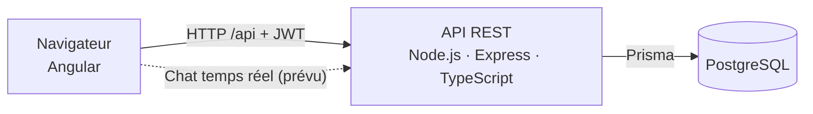
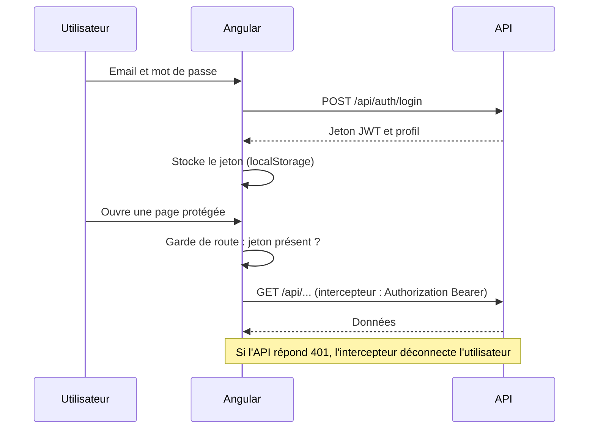

# SkillBridge
 
**Plateforme d'échange de compétences entre étudiants, sans argent.**
Quelqu'un qui sait enseigner *X* et veut apprendre *Y* est mis en relation avec quelqu'un qui sait enseigner *Y* et veut apprendre *X*.
 
Code, design, langues, bricolage, musique, méthodologie : chaque compétence est un pont vers une autre.
 
> Projet Web, SUP'COM 2025/2026 : Groupe 7, Arfaoui Seifeddine et Mokchaha Rayhan.
 
---
 
## Sommaire
 
1. [Fonctionnalités](#fonctionnalités)
2. [Architecture](#architecture)
3. [Choix technologiques](#choix-technologiques)
4. [Le matching](#le-matching)
5. [Aperçu de l'API](#aperçu-de-lapi)
6. [Architecture du front-end](#architecture-du-front-end)
7. [Architecture du back-end](#architecture-du-back-end)
8. [Identité visuelle](#identité-visuelle)
9. [Structure du dépôt](#structure-du-dépôt)
10. [Lancer le projet](#lancer-le-projet)
11. [Équipe et organisation](#équipe-et-organisation)
---
 
## Fonctionnalités
 
| Fonctionnalité | Statut |
|---|---|
| Page d'accueil publique (proposition de valeur, fonctionnement en 3 étapes) | Disponible |
| Inscription et connexion (JWT), routes protégées | Disponible |
| Profil membre : informations, compétences enseignées et recherchées (niveau, mode) | Disponible |
| Catalogue des membres : recherche par compétence ou par nom, filtres par catégorie, pagination | Disponible |
| Correspondances personnalisées avec score de 0 à 100 | Disponible |
| Profil public d'un membre | API disponible, page à venir |
| Disponibilités et réservation de sessions | À venir |
| Tableau de bord et suivi des sessions | À venir |
| Chat en temps réel | À venir |
| Avis après une session | À venir |
 
---
 
## Architecture
 
SkillBridge est une **application web à trois niveaux** : une application Angular (interface), une API REST Node.js (logique métier) et une base PostgreSQL (données). Le tout est écrit en **TypeScript de bout en bout**.
 

 
### Principes
 
- **Contrat d'API d'abord (contract-first).** Le fichier [`docs/openapi.yaml`](docs/openapi.yaml) est la source de vérité partagée entre le front et le back. Les types TypeScript du front (`frontend/src/app/core/models/api.models.ts`) reprennent ce contrat.
- **Une API sans état.** L'authentification repose sur un jeton JWT envoyé à chaque requête. Le serveur ne garde aucune session en mémoire.
- **Le front ne parle qu'à l'API.** En développement, le serveur Angular redirige `/api` vers l'API (proxy), ce qui évite les problèmes de CORS (l'API autorise aussi l'origine `http://localhost:4200`).
- **La logique métier vit côté serveur.** Le score de matching, les règles de réservation et la validation des données sont calculés par l'API. Le front affiche et valide en amont pour l'ergonomie.
### Authentification
 

 
Côté API : le mot de passe est haché avec **bcryptjs** avant d'être stocké, et il n'est jamais renvoyé. Le jeton JWT est signé avec `JWT_SECRET` et reste valable 7 jours. Le middleware `requireAuth` le vérifie sur toutes les routes protégées. À la connexion, le message d'erreur est le même quand l'e-mail ou le mot de passe est faux, pour ne pas révéler quels e-mails ont un compte.
 
### Modèle de données
 
Les données sont fortement liées, d'où le choix d'un modèle relationnel :
 
- **Utilisateur** : nom, email, mot de passe haché, présentation, université, année, ville.
- **Compétence** : élément d'un catalogue commun, classé par catégorie (`tech`, `design`, `languages`, `diy`, `daily_life`, `academic`, `music_arts`, `career`).
- **Compétence d'un utilisateur** : relie un utilisateur à une compétence avec un **type** (`teach` ou `learn`), un **niveau** (`beginner`, `intermediate`, `advanced`) et un **mode** (`online`, `in_person`, `both`).
- **Disponibilités** *(prévu, phase 3)* : plages hebdomadaires d'un enseignant.
- **Session** : un créneau entre un enseignant et un apprenant pour une compétence, avec un statut (`pending`, `accepted`, `declined`, `completed`, `cancelled`). *(prévu, phase 3)*
Dans la base actuelle (migration `init`), les tables sont `users`, `skills` et `user_skills`. La clé de `user_skills` est (utilisateur, compétence, type) : un membre peut donc à la fois enseigner et chercher la même compétence, mais pas la déclarer deux fois avec le même type. Les disponibilités et les sessions seront ajoutées par une nouvelle migration.
 
---
 
## Choix technologiques
 
| Couche | Technologie | Pourquoi |
|---|---|---|
| Interface | **Angular** | SkillBridge n'est pas une page vitrine : c'est une application avec des comptes, des écrans protégés, beaucoup de formulaires et, à terme, un chat. Angular fournit tout cela sans assembler de bibliothèques tierces. |
| API | **Node.js + Express + TypeScript** | Un seul langage pour tout le projet. Le modèle non bloquant de Node convient aux échanges fréquents et courts (messages, réservations). Express reste léger et lisible. |
| Validation | **Zod** | Les entrées de l'API sont validées avec des schémas typés. |
| Sécurité | **bcryptjs**, **JWT** | Mots de passe hachés, authentification sans état par jetons. |
| Base de données | **PostgreSQL** | Modèle relationnel : intégrité des relations entre utilisateurs, compétences, sessions. Les transactions (déjà utilisées pour enregistrer un profil) serviront à empêcher qu'un créneau soit réservé deux fois. |
| Accès aux données | **Prisma** | Le schéma est décrit dans un fichier typé ; Prisma génère les migrations et le client d'accès. |
| Temps réel (prévu) | **WebSocket** | Messagerie instantanée entre membres. |
| Environnement | **Docker Compose** | Même base de données pour les deux développeurs, lancée en une commande. |
| Collaboration | **GitHub** | Branches, pull requests, suivi des tâches avec GitHub Projects. |
 
### Le front-end en détail
 
| Choix | Raison |
|---|---|
| **Composants standalone et routes chargées à la demande** (`loadComponent`) | Pas de modules à maintenir, et chaque page n'est téléchargée que lorsqu'on la visite. |
| **Signals pour l'état**, **RxJS pour l'asynchrone** | Les signals gèrent l'état local de façon simple (filtres, chargement, erreurs). RxJS gère ce qui est temporel : `debounceTime` pour la recherche, `switchMap` pour annuler une requête devenue obsolète. |
| **Intercepteur et garde fonctionnels** | Le jeton est ajouté automatiquement à chaque requête vers `/api`. Les pages privées redirigent vers la connexion si le membre n'est pas connecté. |
| **Formulaires réactifs** | Validation intégrée (inscription, connexion, profil). |
| **CSS maison plutôt qu'Angular Material** | La charte graphique (aplats, coins à 4 px, filets fins, pas de cartes) s'oppose au rendu par défaut de Material. Des variables CSS suffisent. |
| **Proxy de développement** | `/api` est redirigé vers l'API : pas de CORS à configurer, et le front utilise des URL relatives. |
 
---
 
## Le matching
 
L'endpoint `GET /api/matches` renvoie les membres dont les compétences **complètent** les vôtres, du meilleur score au moins bon. Seuls les membres avec au moins un recouvrement sont retournés.
 
Le **score (0 à 100)** est la moyenne de deux pourcentages :
 
1. la part de ce que vous voulez apprendre que le membre peut **vous enseigner** ;
2. la part de ce que vous **enseignez** que le membre veut apprendre.
Un côté vaut 0 si son dénominateur est 0. Un recouvrement à sens unique plafonne donc à 50 : le score récompense les **vrais échanges**, où chacun donne et reçoit.
 
> Exemple : vous voulez apprendre Figma et guitare, et vous enseignez Python. Un membre enseigne Figma et veut apprendre Python. Il peut vous enseigner 1 de vos 2 souhaits (50 %), et il veut apprendre 1 des 1 compétences que vous enseignez (100 %). Score : (50 + 100) / 2 = **75**.
 
Le calcul est fait côté serveur (`backend/src/lib/matching.ts`). La base ne renvoie que les membres qui se recoupent avec vous dans au moins un sens, et les résultats sont triés par score décroissant, puis par nom. Le paramètre `limit` (20 par défaut, 50 au maximum) borne le nombre de résultats.
 
---
 
## Aperçu de l'API
 
Le contrat complet (schémas, codes d'erreur, exemples) se trouve dans [`docs/openapi.yaml`](docs/openapi.yaml).
 
| Méthode | Route | Rôle | Utilisé par le front |
|---|---|---|---|
| `GET` | `/api/health` | Vérifier que l'API répond | Non |
| `POST` | `/api/auth/register` | Créer un compte | Oui |
| `POST` | `/api/auth/login` | Se connecter | Oui |
| `GET` | `/api/users/me` | Profil du membre connecté | Oui |
| `PUT` | `/api/users/me` | Modifier le profil et la liste complète de compétences | Oui |
| `GET` | `/api/skills` | Catalogue de compétences (filtres `category`, `q`) | Oui |
| `GET` | `/api/users` | Rechercher des membres : `skill` (id), `type`, `category`, `level`, `mode`, `university`, `city`, `q` (nom du membre), `page`, `pageSize` | Oui |
| `GET` | `/api/matches` | Correspondances avec score | Oui |
| `GET` | `/api/users/{id}` | Profil public d'un membre | À venir |
| `GET` | `/api/users/{id}/availability` | Disponibilités d'un enseignant | À venir |
| `PUT` | `/api/users/me/availability` | Définir ses disponibilités | À venir |
| `POST` | `/api/sessions` | Demander une session | À venir |
| `GET` | `/api/sessions` | Lister ses sessions | À venir |
| `PATCH` | `/api/sessions/{id}/status` | Accepter, refuser, annuler, terminer | À venir |
 
Toutes les routes, sauf l'inscription, la connexion, le catalogue de compétences et `/api/health`, demandent un jeton : `Authorization: Bearer <jwt>`.
 
### Conventions de l'API
 
- Base : `/api`, échanges en JSON.
- **Erreurs** : `{ "message": "...", "details": [{ "field": "...", "message": "..." }] }`, où `details` n'existe que pour les erreurs de validation. Codes utilisés : 400 (entrée invalide), 401 (jeton absent ou invalide, ou mauvais identifiants), 404 (introuvable), 409 (conflit, par exemple e-mail déjà utilisé).
- **Pagination** : `GET /api/users` renvoie `{ items, page, pageSize, total }` (20 par page par défaut, 50 au maximum).
- **Filtres de recherche** : `skill`, `type`, `category`, `level` et `mode` s'appliquent à une même entrée de compétence du membre, du type demandé (`teach` par défaut). Par exemple, `?category=diy&mode=in_person` renvoie les membres qui enseignent une compétence de bricolage en présentiel.
- **Mise à jour du profil** (`PUT /api/users/me`) : un champ absent reste inchangé, `null` l'efface. Si `skills` est envoyé, la liste complète est remplacée dans une transaction ; sinon les compétences ne changent pas.
---
 
## Architecture du front-end
 
```
frontend/src/app/
├── core/                    # Tout ce qui n'est pas visuel
│   ├── models/              # Types TypeScript issus du contrat OpenAPI
│   ├── auth.ts              # Connexion, inscription, jeton, utilisateur courant
│   ├── auth-interceptor.ts  # Ajoute le jeton, déconnecte sur 401
│   ├── auth-guard.ts        # Protège les pages privées
│   ├── users.ts             # Recherche de membres
│   ├── skills.ts            # Catalogue et suggestions
│   ├── matches.ts           # Correspondances
│   └── labels.ts            # Libellés français des niveaux, modes, catégories
├── layout/
│   └── main-layout/         # Barre de navigation + pages protégées
├── pages/
│   ├── home/                # Accueil public
│   ├── login/               # Connexion
│   ├── register/            # Inscription
│   ├── explorer/            # Catalogue : recherche, filtres, pagination
│   └── my-profile/          # Profil, compétences et correspondances
└── shared/                  # Composants réutilisables
    ├── navbar/              # S'adapte : visiteur ou membre connecté
    ├── auth-shell/          # Mise en page commune connexion / inscription
    └── skill-editor/        # Ajout de compétences avec suggestions
```
 
| Route | Page | Accès |
|---|---|---|
| `/` | Accueil | Public |
| `/connexion` | Connexion | Public |
| `/inscription` | Inscription | Public |
| `/explorer` | Catalogue des membres | Membre connecté |
| `/mon-profil` | Profil, compétences et correspondances | Membre connecté |
 
Règle de structure : **un service par ressource de l'API**, **une page par route**, et tout élément utilisé dans plusieurs pages va dans `shared/`.
 
---
 
## Architecture du back-end
 
```
backend/
├── prisma/
│   ├── schema.prisma     # Modèles (users, skills, user_skills) et énumérations
│   ├── migrations/       # Historique des migrations SQL
│   └── seed.ts           # 37 compétences et 20 membres fictifs
├── src/
│   ├── index.ts          # Serveur Express : middlewares et branchement des routes
│   ├── routes/           # auth, users, skills, matches
│   ├── middleware/
│   │   └── auth.ts       # requireAuth : vérifie le jeton JWT
│   └── lib/
│       ├── prisma.ts     # Client de base de données partagé
│       ├── token.ts      # Création et vérification des jetons
│       ├── user.ts       # Format de réponse d'un membre (public, ou avec e-mail)
│       ├── validation.ts # Format des erreurs de validation (400)
│       └── matching.ts   # Calcul du score de matching
├── requests.http         # Requêtes de test (extension VS Code « REST Client »)
└── .env.example
```
 
Chemin d'une requête : `index.ts` (JSON, CORS) → routeur de la ressource → authentification si la route est protégée → validation Zod de l'entrée → Prisma → réponse JSON.
 
Règle de structure : **un routeur par ressource**, la logique réutilisable dans `lib/`, et les entrées toujours validées avant d'atteindre la base. Pour essayer l'API sans le front, ouvrir `backend/requests.http` et envoyer les requêtes une par une.
 
---
 
## Identité visuelle
 
Aplats uniquement, aucun dégradé. Contraste élevé, coins à 4 px, filets fins plutôt que cartes, beaucoup d'espace blanc. Les valeurs sont définies comme variables CSS dans `frontend/src/styles.css`.
 
| Couleur | Hex | Usage |
|---|---|---|
| Encre | `#12295A` | Texte, boutons |
| Corail | `#E8583F` | Accent : filets, liens, titres de section (jamais du texte courant) |
| Papier | `#F8F5EF` | Fond |
| Sarcelle | `#2F7F79` | Succès |
| Ocre | `#C9962B` | Mise en avant (scores) |
| Ardoise | `#6B7488` | Texte secondaire |
 
**Typographie** : *Fraunces* (semi-bold) pour les titres, *Inter* pour le texte, les formulaires et les boutons.
 
---
 
## Structure du dépôt
 
```
skillbridge/
├── frontend/          # Application Angular
├── backend/           # API Node.js + Prisma
├── docs/
│   └── openapi.yaml   # Contrat d'API
├── WORK_DIVISION.md   # Répartition du travail et règles Git
└── README.md
```
 
---
 
## Lancer le projet
 
### Prérequis
 
- [Node.js](https://nodejs.org) (version LTS récente) et npm
- [Git](https://git-scm.com)
- [Docker Desktop](https://www.docker.com/products/docker-desktop/)
- [Angular CLI](https://angular.dev/tools/cli) : `npm install -g @angular/cli`
### 1. Cloner le dépôt
 
```bash
git clone https://github.com/arfaouiseif/skillbridge.git
cd skillbridge
```
 
### 2. Base de données et API
 
```bash
# Base de données PostgreSQL
docker compose up -d
 
# API
cd backend
npm install
cp .env.example .env        # Windows PowerShell : copy .env.example .env
# Éditer .env : définir JWT_SECRET (voir ci-dessous)
npx prisma migrate dev
npm run seed
npm run dev
```
 
L'API écoute sur `http://localhost:3000`. Vérification : `http://localhost:3000/api/health` doit répondre `{"status":"ok"}`.
 
**Fichier `.env`.** `.env.example` contient `PORT`, `DATABASE_URL` et `JWT_SECRET`. Chaque développeur remplace `JWT_SECRET` par une valeur aléatoire propre à sa machine, sans quoi l'inscription et la connexion échouent. Pour en générer une :
 
```bash
node -e "console.log(require('crypto').randomBytes(32).toString('hex'))"
```
 
Le port de `DATABASE_URL` doit être celui exposé par `docker-compose.yml`. Le fichier `.env` n'est jamais versionné.
 
### 3. Application Angular
 
Dans un second terminal :
 
```bash
cd frontend
npm install
npm start
```
 
L'application est disponible sur `http://localhost:4200`. Les appels à `/api` sont redirigés vers `http://localhost:3000` grâce à `frontend/proxy.conf.json`.
 
### Parcours de démonstration
 
Pour essayer sans créer de compte, le jeu de données contient des membres fictifs, par exemple `sarah.ben.ali@example.com` ou `karim.trabelsi@example.com`, tous avec le mot de passe `Password123!` (développement uniquement).
 
1. Ouvrir l'accueil, puis **Créer mon profil**.
2. S'inscrire : l'application ouvre directement **Mon profil**.
3. Ajouter des compétences dans **J'enseigne** et **Je cherche**, puis **Enregistrer** : les correspondances apparaissent avec leur score.
4. Ouvrir **Explorer** et rechercher une compétence (suggestions pendant la frappe), filtrer par catégorie, changer de page.
5. Se déconnecter, puis se reconnecter.
---
 
## Équipe et organisation
 
La répartition du travail, les étapes du projet et les règles Git sont décrites dans [WORK_DIVISION.md](WORK_DIVISION.md).
Le contrat d'API se trouve dans [docs/openapi.yaml](docs/openapi.yaml).